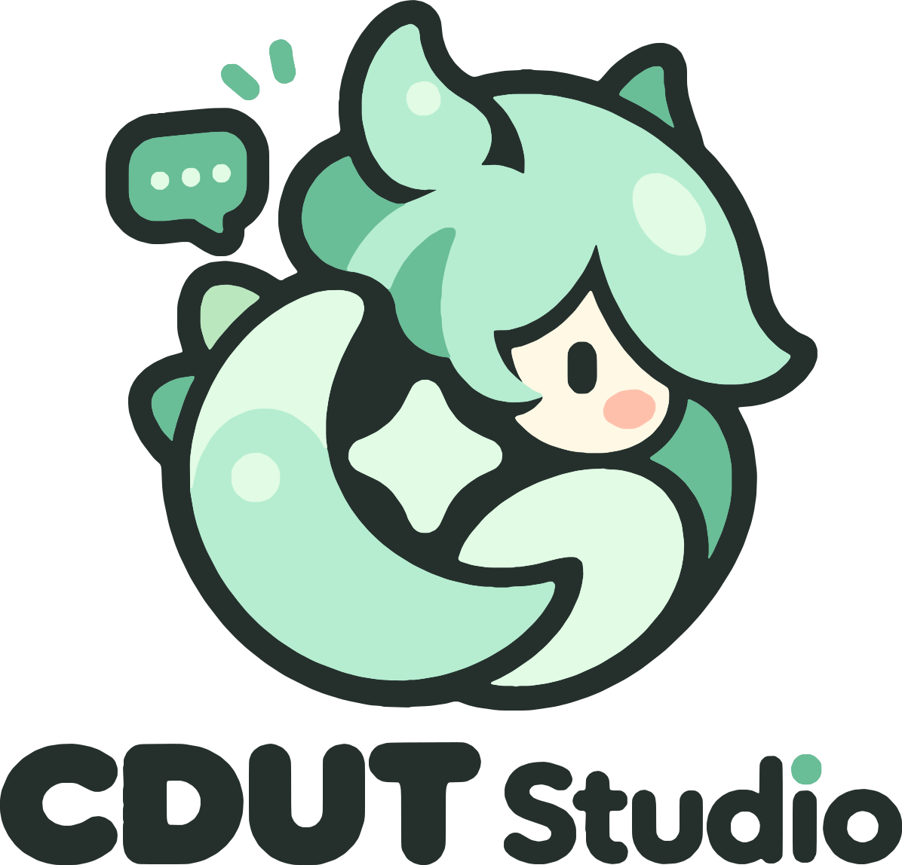
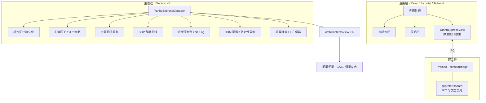

<div align="center">
<p>
  
  &nbsp;&nbsp;&nbsp;
  
</p>

<h1>Origin-Academy From CDUT Studio</h1>

**成都理工大学「问渠学堂」原生桌面工作空间**

*Origin-Academy · Native desktop workspace for CDUT*

<br />


</div>

> **让校园学习回到专注本身。**
>
> Origin-Academy 不是把网页装进窗口的套壳工具，而是一套为问渠学堂重新设计的原生桌面基础设施：更快的页面响应、更稳定的会话、更干净的课堂界面，以及面向大模型时代的感知与控制底座。

---

## 项目定位

成都理工大学「问渠学堂」承载了课程学习、课堂回放与教学资源，但其 Web 形态在桌面端长期面临三个问题：多页面切换割裂、课堂页面信息噪音过多、复杂网络环境下的会话与证书链路不稳定。

Origin-Academy 出自团队作品 CDUT Studio ，以 **Electron `WebContentsView`** 为原生骨架，在保留校方系统与统一认证（CAS）完整链路的前提下，重构了桌面侧的浏览体验、课堂界面与运行时可观测性。应用不代理、不改写远端业务数据，所有增强均发生在本地运行时。

| 项目 | 信息 |
| --- | --- |
| 产品名 | CDUT Studio |
| 当前版本 | `2.0.0` |
| 运行时 | Electron `43.8.4` |
| 支持平台 | Windows x64 / macOS arm64 |
| 默认入口 | 问渠学堂 CAS 统一认证 |
| 许可证 | Apache-2.0 |

---

## 设计原则

- **原生优先** —— 使用 `WebContentsView` 承载真实网页，而非 `webview` 套娃；标签、导航、全屏与视口几何均由主进程精确调度。
- **契约先行** —— 主进程、Preload、渲染层共用契约，IPC 边界只有一处事实来源。
- **确定性工程** —— 以网络与 DOM 双平面静止、跨 Frame 坐标投影、因果 DAG 探测替代固定延时，消除“猜加载完成了没有”。
- **安全默认** —— 证书策略、协议白名单、会话隔离、票据清理全部默认开启，危险路径需要显式动作才能放行。
- **安静可诊断** —— 渲染层不出现任何调试 UI；底层 CDP、NetLog 与事件审计在独立诊断窗口中按需呈现。

---

## 能力矩阵

| 模块 | 核心能力 | 状态 |
| --- | --- | --- |
| **原生浏览器内核** | 多标签、拖拽排序、原生右键菜单、加载进度、后退/前进/刷新、HTML5 全屏、标签拓扑持久化、惰性恢复、后台休眠回收、同源窗口合并 | Done |
| **会话与身份一致性** | 独立持久化分区 `persist:cdut-auth-zone`、Chrome 133 UA 与 Client Hints 对齐、环境指纹加固、CAS 一次性票据清理、青果教务瑞数 `*P` 签名清洗 | Done |
| **安全网关** | 仅网页协议放行、非网页协议内置拦截页、主框架加载失败页、eMudhra 泄露证书链阻断与安全插页、临时放行登记 | Done |
| **问渠课堂工作台** | 课堂页顶栏重写、Nya Player 播放器、课件 PPTX / PDF / HTML 导出、课程智能摘要、双语语音转录、原片视频下载、扫码观看、AI 助手入口 | Done |
| **可观测性** | 独立诊断控制台、控制台 / 网络 / 框架 / 系统事件流、NetLog 落盘、CDP 环形缓冲区、DOM / 源码 / 网络 / 脚本查询 | Done |
| **AI 感知基座** | Vision-Less 感知蒸馏、四级语义剪枝、BID 双射定位、双平面静止判定、跨 Frame 坐标变换、混合自适应事件分派、视口截图 | Done |
| **桌面体验** | 浅色 / 深色 / 跟随系统主题、底层视图防白闪、`prefers-color-scheme` 仿真、皮肤注册表、原子化设置写入 | Done |

---

## 系统架构



**三层职责**

| 层级 | 职责 | 关键实现 |
| --- | --- | --- |
| 渲染层 | 应用外壳、多标签、导航、视口测量与阻断页展示 | React 18、Jotai、Tailwind CSS、lucide-react |
| 安全桥 | 最小权限 API 暴露、事件订阅与 IPC 转发 | `contextBridge`、`ipcRenderer`、共享类型 |
| 主进程 | 标签调度、会话与安全、主题、诊断、AI 基座、课堂页增强 | Electron `WebContentsView`、CDP、Service 单例 |

---

## 技术栈

| 层面 | 技术 |
| --- | --- |
| 桌面运行时 | Electron `43.8.4` |
| 界面框架 | React `18.3`、Jotai `2.10`、Tailwind CSS `3.4`、lucide-react |
| 语言与类型 | TypeScript `5.x`（strict） |
| 构建工具 | Vite `6`、esbuild `0.24`、electron-builder `25` |
| 打包产物 | Windows Portable / NSIS、macOS DMG |
| 持续集成 | GitHub Actions · macOS 14 arm64 |

---

## 快速开始

### 环境要求

- Node.js `20+`（CI 使用 Node `22`）
- npm `10+`
- Windows 10/11 x64，或 macOS Apple Silicon

### 本地开发

```bash
# 安装依赖
npm ci

# 启动 Vite 与 Electron（默认开发端口 5174）
npm run dev
```

开发态配置与用户数据隔离在 `~/.cdutai-dev/`，不会污染正式版本数据。

### 生产构建

```bash
# 类型检查
npm run typecheck

# 构建主进程、两个 Preload 与渲染层
npm run build

# 以构建产物启动桌面应用
npm run start
```

### 打包发布

推送 `v*` 标签会触发 macOS arm64 构建工作流，并将 DMG 附加到对应 Release。CI 环境未配置 Apple 签名证书，产物为未签名版本。

---

## 工程结构

```text
Origin-Academy/
├── apps/
│   └── electron/                  # Origin-Academy 桌面客户端
│       ├── src/
│       │   ├── main/              # 主进程
│       │   │   ├── index.ts       # 应用入口、单实例、窗口生命周期
│       │   │   ├── lib/
│       │   │   │   ├── cdut/yanhu/        # 浏览器内核、标签、主题、CDP、DOM 蒸馏
│       │   │   │   ├── security/          # 证书链安全策略
│       │   │   │   ├── yanhu-ipc.ts       # IPC 注册
│       │   │   │   ├── app-settings.ts    # 设置读写
│       │   │   │   └── config-paths.ts    # 本地数据目录
│       │   ├── preload/           # contextBridge 安全桥
│       │   ├── renderer/          # React 应用外壳与问渠容器
│       │   └── types/             # 应用级类型契约
│       ├── assets/                # 品牌标识与应用图标
│       ├── electron-builder.yml   # 打包配置
│       └── vite.config.ts         # 渲染层构建配置
├── packages/
│   └── shared/                    # 共享契约
│       └── src/
│           ├── types/browser.ts   # 浏览器状态与操作类型
│           ├── types/cdut.ts      # 校园业务与 IPC 契约
│           └── types/cert-interstitial.ts
├── .github/workflows/             # macOS 构建流水线
├── README.md
└── LICENSE
```

---

## 运行数据与隐私

所有运行状态保存在用户主目录，采用配置文件与原子写入，不引入本地数据库，也不向第三方发送遥测。

| 路径 | 内容 |
| --- | --- |
| `~/.cdutai/settings.json` | 主题模式、界面风格等外观设置 |
| `~/.cdutai/yanhu-express/wqxt-tabs.json` | 问渠学堂标签拓扑 |
| `~/.cdutai/yanhu-express/tabs.json` | 智联万站标签拓扑（能力保留） |
| `~/.cdutai/yanhu-express/events.log` | 导航、重载与自愈事件审计 |
| `~/.cdutai/skins/<id>/` | 皮肤 `manifest.json` 与 `skin.css` |

**安全默认**

- 证书链裁决先于校内域名豁免：命中 eMudhra 泄露链的证书一律阻断，需通过内置插页显式临时放行。
- 仅放行 `http/https` 网页地址；`mailto:`、`javascript:`、`file:` 等协议进入内置拦截页。
- Preload 不向页面暴露任何 Node.js 或 Electron 特权 API。
- 复用 Chromium 原生分区承载登录态，不主动读取、嗅探或解密 Cookie。
- `ticket` / `qzticket` 等一次性 SSO 票据在持久化、唤醒与刷新前剔除，避免票据重放导致空壳页面。
- 诊断能力默认静默，仅在独立诊断窗口开启时采集 NetLog 与运行时事件。

---

## 路线图

| 阶段 | 主题 | 内容 |
| --- | --- | --- |
| 已交付 | `1.0 Foundations` | 原生多标签浏览器、课堂工作台、安全网关、诊断控制台、AI 感知基座 |
| 已交付 | `AI Alignment` | 主流大模型接入、模型选择、对话会话、安全对齐与实验室测试 |

---

## 开发约定

- **契约先行**：新增 IPC 或跨层数据先落到 `packages/shared`，避免主进程与渲染层各自维护影子类型。
- **渲染层保持纯净**：调试、采集与自动化能力留在主进程；界面只呈现用户可理解的状态。
- **纯逻辑可单测**：安全裁决、DOM 蒸馏、静止判定、坐标变换等模块不直接依赖 Electron 运行时。
- **数据落盘可恢复**：配置写入采用原子写入，损坏数据回退默认值，保证异常断电后仍可启动。
- **提交前自检**：至少执行 `npm run typecheck` 与 `npm run build`。

---

## 许可证

本项目采用 [Apache License 2.0](LICENSE) 许可协议。

<div align="center">
<br />
**Origin-Academy From CDUT Studio** · 雫窝中央实验室 · 2026

*Built for focus, engineered for trust.*

</div>
